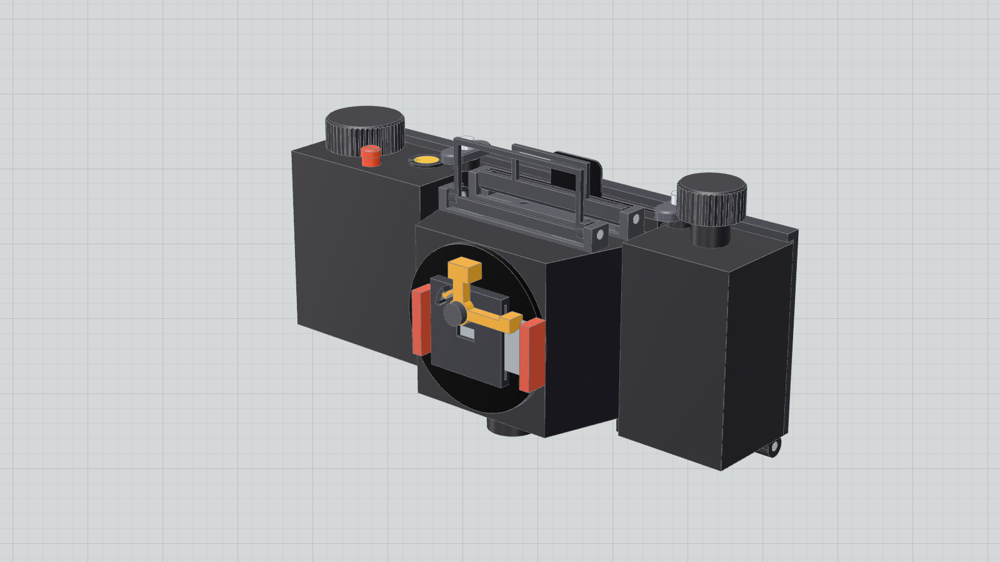

# X-Pan pinhole camera

A panoramic film camera you print yourself: **65 × 24 mm** frames on ordinary **135 film**, through a **0.30 mm brass pinhole** at **f/167** — the Hasselblad X-Pan format on the cheapest film there is.

The camera is modular, and the whole design is parametric. Every dimension lives in one Python file, the geometry is checked against the design by code on every change, and the page that presents the camera reads its numbers from the same CAD export.

**[Live site](https://xpan-film-camera-3d-print.vercel.app)** · [Design document](docs/design/camera.md) · [Bill of materials](docs/bom.md)



## How it goes together

```
[Lens module]  ←→  [Body module]  ←→  [Film back]
 M42 mount          dark chamber      film transport
 pinhole + shutter  + viewfinder      + film gate
```

| Module | Job |
|---|---|
| **Film back** | Holds the cassette and the take-up spool, sets the film plane with a 65 × 24 mm gate, counts perforations with a 14-tooth sprocket and locks the advance after one turn, and carries the dark slide |
| **Body** | Light-tight 50 mm chamber from the M42 front mount to the film plane, folding two-frame viewfinder, hook-and-latch mount to the back |
| **Pinhole module** | M42 cap with a hand-drilled 0.30 mm brass pinhole plus a sliding blade shutter (an optical lens module is future work) |

The film back owns the film plane, so any body module registers against the same datum. Swap bodies, keep the back.

## The format

| Parameter | Value |
|---|---|
| Frame | 65 × 24 mm (2.7:1) |
| Film | 135 / 35 mm, standard cassette |
| Perforation pitch | 4.750 mm (KS-1870) |
| Perforations per frame | 14 |
| Film advance per frame | 66.5 mm exactly — set by the tooth count, so hub-diameter error does not accumulate |
| Sprocket | 14 teeth, 21.17 mm pitch diameter: one revolution, one frame |
| Frames per 36-exposure roll | about 20 before loading waste |
| Pinhole | 0.30 mm at 50.0 mm from the film — f/167, near the Rayleigh optimum for that focal length |
| Lens mount | M42 × 1 mm |
| Material | Black PETG, FDM; bought metal and plastic where printing is worse |

## What you print, what you buy

24 printed parts and 28 bought ones — a length of 3 mm stainless rod, an M42 body cap and rear cap pair, 0.5 mm aluminium for the dark slide and shutter blade, 0.05 mm brass shim, springs, felt, and M3 inserts. Print tests before the camera: the fit parameters are the ones a printer gets wrong, so `Fit` keeps them in one place.

## Repository

| Path | Contents |
|---|---|
| `cad/` | build123d source: `params.py` (every dimension), `parts/`, `mechanisms.py`, `export.py`, `checks.py`, `check_areas/`, `tests/` |
| `viewer/` | Vite + React + react-three-fiber: the public presentation at `/`, the private workshop at `/workshop.html` |
| `docs/` | Design documents, bill of materials, research, figures, images, specs |
| `out/` | Generated exports. The manifest, the GLBs and the stills are committed because the site is built from them; STL and STEP are not |

## Working on it

Needs [uv](https://docs.astral.sh/uv/) (Python 3.12) and Node with pnpm.

| Command | What it does |
|---|---|
| `uv sync` | Installs build123d into `.venv` |
| `uv run python cad/export.py` | Builds every part; writes `out/stl`, `out/step`, `out/glb` and `out/manifest.json` |
| `uv run python cad/checks.py` | Layout and geometry checks; exit 1 on any failure |
| `uv run python cad/tests/test_checks.py` | Seeds known design errors and proves the checks catch each one (about 7 minutes on 8 cores) |
| `pnpm --dir viewer install` | Installs the viewer once |
| `pnpm --dir viewer dev` | Dev server on http://localhost:5173/ (`/` presentation, `/workshop.html` review viewer) |
| `pnpm --dir viewer typecheck` · `test` | Typecheck, and the vitest suite (reads the real `out/manifest.json`) |
| `pnpm --dir viewer stills` | Captures each chapter into `out/stills/` plus the 1200 × 630 `og.png` share card |
| `pnpm --dir viewer build:public` | Builds the presentation alone into `viewer/dist-public/`, then fails if any workshop code or CAD file got in |
| `pnpm --dir viewer verify` | Drives the built site at desktop and phone sizes, with reduced motion and with WebGL off |

Run the export before the viewer: it only ever reads `out/manifest.json` and `out/glb/`.

The rules behind the code — dimensions only in `params.py`, a geometry check for everything a part must get right, a seeded error proving each check bites — are in [AGENTS.md](AGENTS.md).

## Deploying

The site is the presentation only: two pages, no workshop, no STL or STEP files.

Vercel builds `main` on every push using [`vercel.json`](vercel.json): `pnpm --dir viewer build:public` from `viewer/`, publishing `viewer/dist-public/`. The build needs the generated site data, which is why `out/manifest.json`, `out/glb/` and `out/stills/` are committed. After changing the CAD, re-run the export and the stills and commit them with the change:

```sh
uv run python cad/export.py
pnpm --dir viewer stills
```

`SITE_URL` overrides the canonical and Open Graph URLs at build time (the default is the deployment above).

## Status

Phases 1–5 of the [roadmap](docs/superpowers/specs/2026-10-21-redesign-roadmap-design.md) are done: the film back, the pinhole body and the pinhole module are modelled, checked and presented. `cad/checks.py` passes in full — no unintended interference, every part on a 180 mm bed, the frame cycle advancing exactly 66.5 mm and ending locked, and the optical distances correct.

Not done yet: the print package (phase 6) — print orientation and settings, coupons for the printer-dependent fits, and the assembly guide. Nothing here has been printed or run with film.

## Licence

[CERN-OHL-S-2.0](LICENSE) — the strongly reciprocal open hardware licence. Use, study, modify and share the design; if you distribute a modified camera or its design files, they stay under the same licence.
